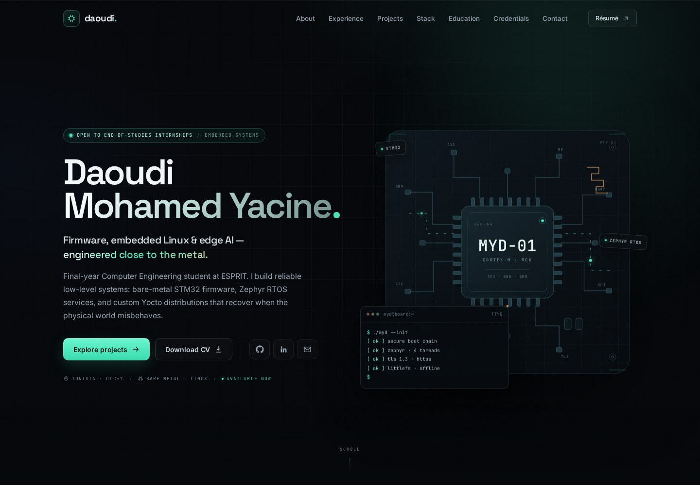

# Daoudi Mohamed Yacine — Portfolio

A hand-built, single-page portfolio for an embedded systems engineer. No frameworks, no
build step, no external runtime dependencies — just HTML, CSS, vanilla JS, and self-hosted
variable fonts.



## Highlights

- Custom "hardware lab" design system: dark PCB palette, copper accents, circuit typography.
- Hand-drawn inline SVG artwork for every project (radar, Linux stack, boot flow, neural net, parking lot).
- Animated MCU board with signal pulses, boot log, 3D pointer tilt, and scroll-aware navigation.
- Fully responsive, keyboard accessible, and respects `prefers-reduced-motion`.
- Self-hosted fonts (Space Grotesk, Inter, JetBrains Mono) — zero third-party requests.
- SEO-ready: Open Graph/Twitter metadata, JSON-LD Person schema, SVG favicon.

## Structure

```
index.html              all content and inline SVG artwork
assets/css/styles.css   design system + responsive layout
assets/js/main.js       navigation, reveal, counters, tilt, copy email
assets/fonts/           self-hosted variable WOFF2 files
assets/resume.pdf       downloadable CV
assets/og.png           social sharing image
screenshots/            README preview images
```

## Preview locally

```bash
python3 -m http.server 4173
# open http://localhost:4173
```

## Deploy

This is a static site, ready for GitHub Pages:

1. Create a repository named `pycine.github.io` (or use a project repo).
2. Copy `index.html`, `assets/`, and (optionally) `README.md` to the repository root.
3. Commit and push to `main`, then enable Pages → Deploy from branch → `main` → `/ (root)`.

No CI or build configuration is required.

> If you publish under a different domain or repository path, update the canonical URL and
> the `og:url` / `og:image` values in `index.html` to match.

## Customize

- **Colours and type:** edit the design tokens at the top of `assets/css/styles.css`.
- **Copy and links:** all content lives in `index.html`.
- **CV:** replace `assets/resume.pdf` (used by every download button).
- **Social image:** replace `assets/og.png` (1200 × 630).

## Content

All content is sourced from the CV (`Mohamed_Yacine_Resume.pdf`) and its embedded
certificate verification links. To update the CV, replace `assets/resume.pdf`.
