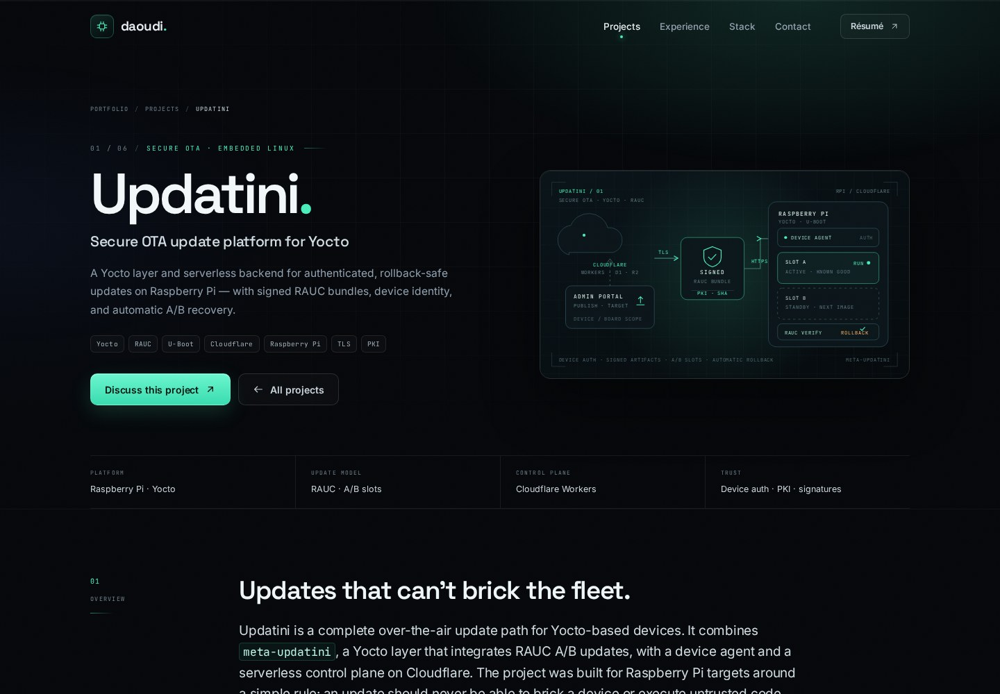

# Daoudi Mohamed Yacine — Portfolio

A hand-built portfolio for an embedded systems engineer: a main page plus a dedicated
case study for every project. No frameworks, no build step, no external runtime
dependencies — just HTML, CSS, vanilla JS, and self-hosted variable fonts.


A case study from the new project pages:



## Highlights

- Custom "hardware lab" design system: dark PCB palette, copper accents, circuit typography.
- Six projects, each with a dedicated case-study page and hand-drawn inline SVG artwork (OTA update flow, radar, Linux stack, boot recovery, neural net, parking lot).
- Animated MCU board with signal pulses, boot log, 3D pointer tilt, and scroll-aware navigation.
- Fully responsive, keyboard accessible, and respects `prefers-reduced-motion`.
- Self-hosted fonts (Space Grotesk, Inter, JetBrains Mono) — zero third-party requests.
- SEO-ready: Open Graph/Twitter metadata, JSON-LD Person schema, SVG favicon.

## Structure

```
index.html              home page + project cards
projects/*.html         one case study per project
assets/css/styles.css   design system + responsive layout
assets/css/project.css  case-study page layout
assets/js/main.js       navigation, reveal, counters, tilt, copy email
assets/fonts/           self-hosted variable WOFF2 files
assets/resume.pdf       downloadable CV
assets/og.png           social sharing image
screenshots/            README preview images
```

## Preview locally

```bash
python3 -m http.server 4173
# open http://localhost:4173
```

## Deploy

This is a static site, ready for GitHub Pages:

1. Push this repository to GitHub.
2. In the repository, open **Settings → Pages**.
3. Deploy from branch `main`, folder `/ (root)`.

No CI or build configuration is required.

> Canonical and Open Graph URLs are set for `https://pycine.github.io/`, the GitHub Pages
> site served from this repository. If you deploy to another domain, update the URLs in
> `index.html` and `projects/*.html`.

## Customize

- **Colours and type:** edit the design tokens at the top of `assets/css/styles.css`.
- **Copy and links:** home content lives in `index.html`; project case studies live in `projects/`.
- **CV:** replace `assets/resume.pdf` (used by every download button).
- **Social image:** replace `assets/og.png` (1200 × 630).

## Content

Content is sourced from the CV (`Mohamed_Yacine_Resume.pdf`), its embedded certificate
verification links, and the Updatini project notes supplied for the portfolio. To update the
CV, replace `assets/resume.pdf`.
